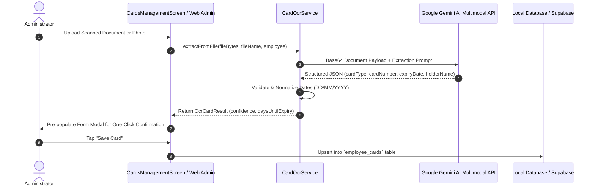

# 11. Cards Management, Gemini AI OCR & Automated Compliance Robot

## Overview
The **Cards Management & Compliance Engine** provides end-to-end document tracking, verification, expiry alerting, and multi-channel notification automation for employee statutory documents and project access passes. In mission-critical field operations and construction engineering, unexpired statutory documents (such as Emirates IDs, residence visas, security access badges, and medical insurance) are mandatory for legal site access and avoidance of municipal penalties.

The system combines:
1. **Gemini Multimodal AI Vision & Document Intelligence** (`CardOcrService`) for automated document data extraction.
2. **Multi-tier Expiry Status Tracking** (Expired, Critical ≤3 days, Expiring Soon ≤30 days, Valid).
3. **Automated Multi-Channel Notification Robot** using Supabase `pg_cron` and `pg_net` to broadcast automated daily alerts via **Resend Email API** and **CallMeBot WhatsApp API**.
4. **Client-side Manual Triggers** for 1-click WhatsApp messaging and pre-composed email drafting.
5. **Full Parity Across Flutter Mobile/Web and Standalone Web Admin** (`web_admin/`).

---

## 1. Supported Document & Card Types

| Card Type Code | Human-Readable Name | Description & Regulatory Context |
| :--- | :--- | :--- |
| `EMIRATES_ID` | Emirates ID | Official United Arab Emirates national identity card issued by ICP. Mandatory for all residents. |
| `VISA` | Employment Residence Visa | UAE residency permit stamped or issued digitally by GDRFA/ICP. |
| `PASSPORT` | International Passport | Employee national passport document. |
| `INSURANCE` | Health & Medical Insurance | Statutory medical insurance policy card required for labor compliance. |
| `MOPA_PASS` | MOPA Security Pass | Ministry of Presidential Affairs high-security facility access clearance pass. |
| `CISPA_PASS` | CISPA Access Pass | Critical Infrastructure and Coastal Protection Authority access permit. |
| `CUSTOM_PASS` | Custom Site / Safety Permit | Client-specific work permit, contractor gate pass, safety badge, or driving license. |

---

## 2. Gemini Multimodal AI Vision OCR Engine (`CardOcrService`)

### Architecture & Capabilities
The application integrates Google's **Gemini Multimodal AI Vision** (`google_generative_ai` and REST API) to eliminate tedious manual data entry and human typing errors when uploading card photos and scanned documents:

1. **Multi-Format Input**: Accepts JPEG, PNG, WEBP images, and camera captures.
2. **Automated Metadata Extraction**:
   - **Card Type**: Automatically classifies document into `EMIRATES_ID`, `VISA`, `PASSPORT`, `INSURANCE`, `MOPA_PASS`, `CISPA_PASS`, or `CUSTOM_PASS`.
   - **Card / ID Number**: Extracts official ID numbers (e.g., Emirates ID `784-XXXX-XXXXXXX-X`, Visa numbers, Passport numbers).
   - **Full Name**: Reads employee legal name from document and fuzzy-matches against the selected employee profile.
   - **Issue Date**: Extracts issuing date and normalizes it to standard `YYYY-MM-DD` / `DateTime`.
   - **Expiry Date**: Extracts document expiration date with multi-format pattern recognition (`DD/MM/YYYY`, `DD-MM-YYYY`, `YYYY-MM-DD`, English text months, and Arabic-indic digits).
3. **Confidence Scoring**: Returns confidence metrics (`0.0` to `1.0`), flagging low-confidence extractions for manual operator review.
4. **Resilient Fallback**: If Gemini API is unreachable or no API key is configured, an integrated local heuristic parser inspects file metadata and structural patterns to suggest sensible defaults.

### OCR Data Flow Sequence


---

## 3. Document Expiry Lifecycle & Categorization

The lifecycle of every card is dynamically calculated in real time against the current calendar day:

$$\text{daysUntilExpiry} = \text{expiryDate} - \text{today}$$

| Status Category | Condition | Visual Indicator | Operational Impact |
| :--- | :--- | :--- | :--- |
| **Expired** | $\text{daysUntilExpiry} < 0$ | Red Outline & Badge (`EXPIRED`) | Immediate compliance violation. Site access revoked. Alert sent to operations. |
| **Critical** | $0 \le \text{daysUntilExpiry} \le 3$ | Crimson / Pulsing Red (`Expires in X days`) | Urgent priority. Automated daily email and WhatsApp notifications dispatched. |
| **Expiring Soon** | $4 \le \text{daysUntilExpiry} \le 30$ | Amber / Orange (`X days left`) | Renewal queued with HR / PRO team. Included in weekly summary reports. |
| **Valid** | $\text{daysUntilExpiry} > 30$ | Green (`Valid - X days left`) | Fully compliant. Normal active status. |

---

## 4. Automated Multi-Channel Notification Robot

To guarantee compliance without manual administration, the system incorporates an autonomous compliance notification robot configured in [`backend/supabase_cron_job.sql`](../backend/supabase_cron_job.sql).

### A. Supabase Database Cron (`pg_cron` & `pg_net`)
- **Schedule**: Executes daily at **08:00 AM Gulf Standard Time (GST)** (04:00 UTC):
  ```sql
  SELECT cron.schedule(
      'daily-card-expiry-compliance-check',
      '0 4 * * *',
      $$SELECT public.process_daily_card_compliance_alerts();$$
  );
  ```
- **Execution Mechanism**:
  1. Identifies all cards expiring within **3 days** ($\text{daysRemaining} \le 3$) or already expired.
  2. Queries target administrators from `public.compliance_notification_settings`:
     - Default Email: `sr.irshath@gmail.com, nasuru@fusionmaint.com`
     - Default WhatsApp: `+971586939371`
  3. Formats professional multi-card compliance summaries.
  4. Triggers non-blocking HTTP POST requests using the `pg_net` PostgreSQL extension.

### B. Automated Email Broadcast (Resend API)
- Sends HTML and plain-text executive alerts via **Resend API** from `compliance@fusionmaint.org`.
- Includes complete employee details: Employee Code, Name, Designation, Department, Card Name, Card Number, and Expiration Date.

### C. Automated WhatsApp Broadcast (CallMeBot API)
- Automatically dispatches pre-formatted WhatsApp text messages to operation managers.
- Utilizes RFC 3986 PL/pgSQL encoding (`url_encode`) to guarantee flawless transmission of special characters, emojis, and line breaks.

### D. Client-Side Manual Notification Triggers
In addition to automated background cron jobs, administrators can trigger manual alerts with one click directly from the UI:
- **Direct WhatsApp Click-to-Chat**: Generates a pre-filled `https://wa.me/971586939371?text=...` deep link that opens WhatsApp Web or the WhatsApp mobile app.
- **Direct Email Dispatch**: Generates a pre-composed `mailto:` action or triggers the `CardExpiryNotificationService.sendEmailNotification()` background HTTP service.

---

## 5. Database Schema & Tables

### A. `employee_cards` Table
```sql
CREATE TABLE IF NOT EXISTS public.employee_cards (
    id UUID PRIMARY KEY DEFAULT uuid_generate_v4(),
    organization_id UUID NOT NULL REFERENCES public.organizations(id) ON DELETE CASCADE,
    employee_id UUID NOT NULL REFERENCES public.employees(id) ON DELETE CASCADE,
    card_type VARCHAR(50) NOT NULL CHECK (card_type IN (
        'EMIRATES_ID', 'VISA', 'PASSPORT', 'INSURANCE', 'MOPA_PASS', 'CISPA_PASS', 'CUSTOM_PASS'
    )),
    card_name VARCHAR(100) NOT NULL,
    card_number VARCHAR(100) NOT NULL,
    issue_date DATE,
    expiry_date DATE NOT NULL,
    document_url TEXT,
    file_name VARCHAR(255),
    notes TEXT,
    last_notified_at TIMESTAMP WITH TIME ZONE,
    is_deleted BOOLEAN NOT NULL DEFAULT FALSE,
    deleted_at TIMESTAMP WITH TIME ZONE,
    created_at TIMESTAMP WITH TIME ZONE DEFAULT CURRENT_TIMESTAMP,
    updated_at TIMESTAMP WITH TIME ZONE DEFAULT CURRENT_TIMESTAMP
);

CREATE INDEX IF NOT EXISTS idx_employee_cards_emp ON public.employee_cards(employee_id);
CREATE INDEX IF NOT EXISTS idx_employee_cards_org ON public.employee_cards(organization_id);
CREATE INDEX IF NOT EXISTS idx_employee_cards_expiry ON public.employee_cards(expiry_date);
```

### B. `compliance_notification_settings` Table
```sql
CREATE TABLE IF NOT EXISTS public.compliance_notification_settings (
    id UUID PRIMARY KEY DEFAULT uuid_generate_v4(),
    organization_id UUID REFERENCES public.organizations(id) ON DELETE CASCADE,
    resend_api_key TEXT,
    callmebot_api_key TEXT,
    target_email TEXT NOT NULL DEFAULT 'sr.irshath@gmail.com, nasuru@fusionmaint.com',
    target_phone TEXT NOT NULL DEFAULT '971586939371',
    is_automated_enabled BOOLEAN NOT NULL DEFAULT TRUE,
    last_run_at TIMESTAMP WITH TIME ZONE,
    last_run_status TEXT,
    created_at TIMESTAMP WITH TIME ZONE DEFAULT CURRENT_TIMESTAMP,
    updated_at TIMESTAMP WITH TIME ZONE DEFAULT CURRENT_TIMESTAMP
);
```

---

## 6. User Interface & Key Workflows

### Flutter Mobile & Web Admin App
- **Entry Point**: Accessible via Admin Dashboard quick-actions or Drawer (`CardsManagementScreen`).
- **KPI Summary Cards**: Real-time counts for **Total Cards**, **Expired**, **Critical (≤3d)**, **Expiring Soon (≤30d)**, and **Valid**.
- **Filter Tabs**: Filter by `All`, `Expired`, `Expiring`, `Valid`, or specific Card Type (`Emirates ID`, `Visa`, `Passport`, etc.).
- **Smart Search**: Filter cards instantly by Employee Name, Employee Code, Card Name, or Card Number.
- **Card Action Menu**:
  - View Document / Scanned Image.
  - Edit Details & Dates.
  - Delete Card (Soft delete with local and cloud sync).
  - Quick Notify (WhatsApp or Email).

### Standalone Web Admin Portal (`web_admin/`)
- High-speed vanilla JavaScript integration in `web_admin/app.js` and `web_admin/index.html`.
- **Card Compliance Grid**: Renders responsive cards with employee avatars, status pills, and remaining days badges.
- **OCR Upload Modal**: Drag-and-drop or file upload triggering Gemini Vision OCR.
- **Excel Compliance Export**: Generates `Employee_Cards_Compliance_Report_YYYY-MM-DD.xlsx` containing all active cards, employee mappings, and expiration dates.

---

## 7. Key Source Files & Responsibilities

| File Path | Description |
| :--- | :--- |
| [`lib/features/admin/domain/employee_card.dart`](../lib/features/admin/domain/employee_card.dart) | Domain model for employee cards, expiry properties, and JSON serialization. |
| [`lib/core/services/card_ocr_service.dart`](../lib/core/services/card_ocr_service.dart) | Document intelligence & Gemini AI Vision OCR extraction service. |
| [`lib/core/services/card_expiry_notification_service.dart`](../lib/core/services/card_expiry_notification_service.dart) | Multi-channel notification service for WhatsApp messages, email drafting, and API calls. |
| [`lib/features/admin/presentation/cards_management_screen.dart`](../lib/features/admin/presentation/cards_management_screen.dart) | Full-featured Flutter UI for cards inventory, OCR scanner dialog, and compliance filtering. |
| [`backend/supabase_cron_job.sql`](../backend/supabase_cron_job.sql) | Automated `pg_cron` and `pg_net` SQL script for daily automated 8:00 AM compliance alerts. |
| [`web_admin/app.js`](../web_admin/app.js) | Standalone Web Admin controller for cards management, Gemini OCR integration, and WhatsApp dispatch. |
| [`test/auto_checkout_24h_test.dart`](../test/auto_checkout_24h_test.dart) | Unit test suite validating card calculations and auto checkout integration. |
