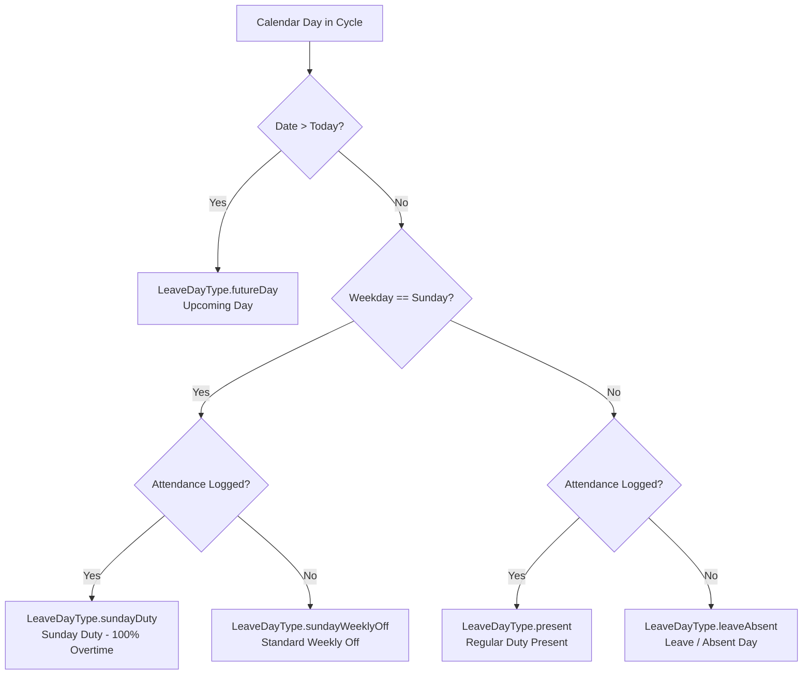

# 12. Enterprise Leave Records, Weekly Off Rules & Configurable Salary Cycles

## Overview
The **Leave Records & Salary Cycle Engine** aligns the workforce attendance tracking system with real-world enterprise operations in the Gulf / UAE region. Standard enterprise payroll and field service contracts operate on distinct calendar cycles (running from the **25th of the prior month to the 24th of the current month**) rather than standard calendar months (1st to 30th/31st). Furthermore, operational regulations designate **Sunday as the mandatory weekly off day**, with special compensation and overtime rules governing Sunday shifts.

---

## 1. Company Salary Cycle Engine (`SalaryCycle` & `SalaryCycleHelper`)

### Calendar Boundary Definition
Each organizational salary cycle runs continuously from:
- **Start Timestamp**: `25th` of the start month at `00:00:00.000`
- **End Timestamp**: `24th` of the subsequent month at `23:59:59.999`
- **Target Salary Month**: The month in which the `24th` (cutoff date) occurs.

*Example*: For the **November 2026 Salary Cycle**, the active period begins on **October 25, 2026 at 00:00** and concludes on **November 24, 2026 at 23:59:59**.

### Dynamic Cycle Resolution Algorithm
When an operator or employee selects any reference date, `SalaryCycle.fromDate(DateTime date)` resolves the target cycle:
```dart
if (date.day >= 25) {
  // Cycle runs from 25th of current month to 24th of next month
  startDate = DateTime(date.year, date.month, 25, 0, 0, 0);
  endDate = DateTime(date.year, date.month + 1, 24, 23, 59, 59, 999);
  salaryMonth = date.month + 1;
} else {
  // Cycle runs from 25th of previous month to 24th of current month
  startDate = DateTime(date.year, date.month - 1, 25, 0, 0, 0);
  endDate = DateTime(date.year, date.month, 24, 23, 59, 59, 999);
  salaryMonth = date.month;
}
```

### Salary Cycle Metrics (`SalaryCycleMetrics`)
Across any resolved salary cycle, the engine calculates:
- **`totalCalendarDays`**: Total elapsed calendar days within the period (typically 30 or 31 days).
- **`scheduledWorkingDays`**: Total scheduled working days (Monday through Saturday, excluding Sundays).
- **`sundayCount`**: Total number of Sundays (weekly off days) occurring in the cycle.
- **`totalWorkedHours`**: Aggregate duty hours logged by an employee or workforce.
- **`regularHours`**: Standard hours (capped at 8.0h per standard working day).
- **`overtimeHours`**: Total overtime accrued (>8.0h on regular days + 100% of Sunday duty).

---

## 2. Leave Ledger & Attendance Categorization (`LeaveCalculator`)

The system automatically generates a daily compliance ledger for every calendar day in the cycle, classifying each day into one of five definitive statuses:



### Categorization Table (`LeaveDayType`)

| Enum Value | Label | Description & Calculation Rule |
| :--- | :--- | :--- |
| `present` | **Present** | Scheduled working day (Monday–Saturday) with at least one valid attendance check-in. |
| `leaveAbsent` | **Leave / Absent** | Scheduled working day (Monday–Saturday) where no attendance was logged. Counted as unapproved absence or approved leave. |
| `sundayWeeklyOff` | **Sunday (Weekly Off)** | Sunday with no attendance logged. Standard designated weekly rest day. Does not reduce attendance percentage. |
| `sundayDuty` | **Sunday Duty (Worked)** | Sunday where employee logged duty. Compensated with special overtime premium. |
| `futureDay` | **Upcoming** | Unreached calendar dates within the active cycle. Excluded from compliance ratios. |

### Aggregated Employee Leave Summary (`EmployeeLeaveSummary`)
For each employee, the `LeaveCalculator.calculateEmployeeLeaveSummary()` calculates:
- **Scheduled Working Days**: Total non-Sunday calendar days up to the current date.
- **Present Days**: Days with verified duty.
- **Leave / Absent Days**: Scheduled working days missed.
- **Sunday Weekly Offs**: Approved rest days enjoyed.
- **Sunday Duties**: Rest days worked in the field.
- **Attendance Percentage**: 

$$\text{Attendance Rate} = \left( \frac{\text{Present Days}}{\text{Scheduled Working Days to Date}} \right) \times 100\%$$

---

## 3. Sunday Overtime & Holiday Duty Rule

In standard Gulf workforce agreements, regular daily working hours on Monday through Saturday are capped at **8.0 hours** (`standardRegularHoursPerDay = 8.0`), with excess hours treated as standard overtime.

**Special Sunday Rule**:
1. Sunday is the official organizational weekly off day.
2. If an employee logs attendance on a Sunday (`r.eventTimestamp.weekday == DateTime.sunday`), the system automatically treats the entire shift duration as **100% Overtime Hours**:
   - **Regular Hours** = `0.0 hours`
   - **Overtime Hours** = `totalWorkedHours`
3. This guarantees accurate payroll overtime export without requiring manual timesheet adjustments by payroll administrators.

---

## 4. 24-Hour Auto-Checkout Safety Guard

To prevent timesheet distortion when field personnel forget to perform step `4. Office Check-Out`, the system enforces an automated 24-hour capping safeguard:

1. **Shift In-Progress vs. Stale Shift**:
   - If a shift has an `Office Check-In` with no check-out, and the elapsed duration is **under 24 hours**, the shift remains active in the UI as **In Progress**.
2. **24-Hour Overrun Capping**:
   - If an unclosed shift crosses **24 hours** from initial check-in time:
     - The shift is automatically finalized and marked as `isAutoCompleted: true`.
     - Daily work hours are safely capped at **8.0 standard regular hours**.
     - Overtime hours are strictly set to **0.0 hours**.
3. **Audit Trail**: The system records the synthetic check-out in local and cloud stores with the notation `Auto Check-Out (24-Hour Limit Reached)`, ensuring timesheet metrics are never corrupted by runaway durations (e.g. 72-hour continuous shifts).

---

## 5. Employee Identity Reconciliation (`EmployeeDirectoryHelper`)

In enterprise environments with legacy personnel data and diverse identification formats, records may reference employee codes with or without branch prefixes (e.g., `1004` vs `N-1004`), leading zeroes, or slight name spelling differences.

The [`EmployeeDirectoryHelper`](../lib/core/utils/employee_directory_helper.dart) provides unified identity matching:
1. **Code Normalization**: Strips department prefixes (`N-`, `D-`, `EMP-`) to resolve the underlying numeric badge number.
2. **Name Normalization**: Sanitizes extraneous punctuation, titles, and whitespace to match attendance records against official personnel profiles.
3. **Avatar Mapping**: Automatically links employee codes to official portrait assets (`assets/images/employees/1004.png` or `N-1003.png`) across both Flutter and Web Admin.

---

## 6. Key Source Files & Responsibilities

| File Path | Description |
| :--- | :--- |
| [`lib/core/utils/salary_cycle_helper.dart`](../lib/core/utils/salary_cycle_helper.dart) | Core utility managing 25th–24th salary cycle resolution, calendar date boundaries, and cycle metrics. |
| [`lib/core/utils/leave_calculator.dart`](../lib/core/utils/leave_calculator.dart) | Calculation engine for daily leave records, Sunday weekly offs, Sunday duties, and attendance percentages. |
| [`lib/core/utils/timesheet_calculator.dart`](../lib/core/utils/timesheet_calculator.dart) | Timesheet aggregation incorporating salary cycles, Sunday 100% OT rules, and 24-hour auto check-outs. |
| [`lib/core/utils/employee_directory_helper.dart`](../lib/core/utils/employee_directory_helper.dart) | Helper for normalizing employee identity, badge numbers, and avatar bindings. |
| [`lib/core/widgets/employee_avatar.dart`](../lib/core/widgets/employee_avatar.dart) | Reusable UI component rendering official portrait photos with fallback initials. |
| [`test/salary_cycle_test.dart`](../test/salary_cycle_test.dart) | Unit test suite verifying 25th–24th boundary transitions and edge cases. |
| [`test/leave_calculator_test.dart`](../test/leave_calculator_test.dart) | Unit test suite validating leave categorization, Sunday off days, and duty detection. |
| [`test/auto_checkout_24h_test.dart`](../test/auto_checkout_24h_test.dart) | Unit tests verifying the 24-hour unclosed shift auto-completion rule. |
