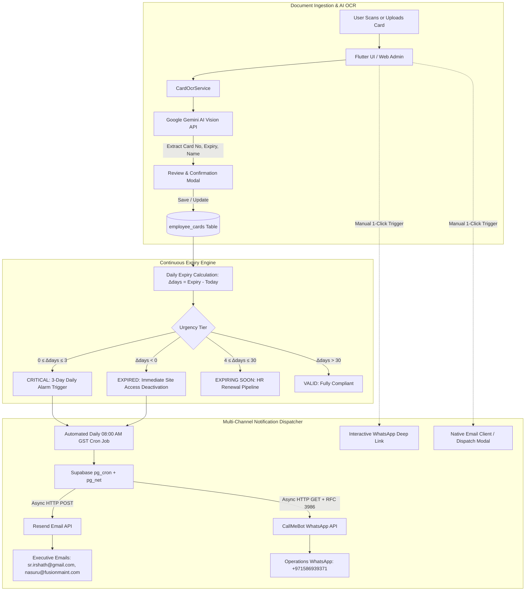
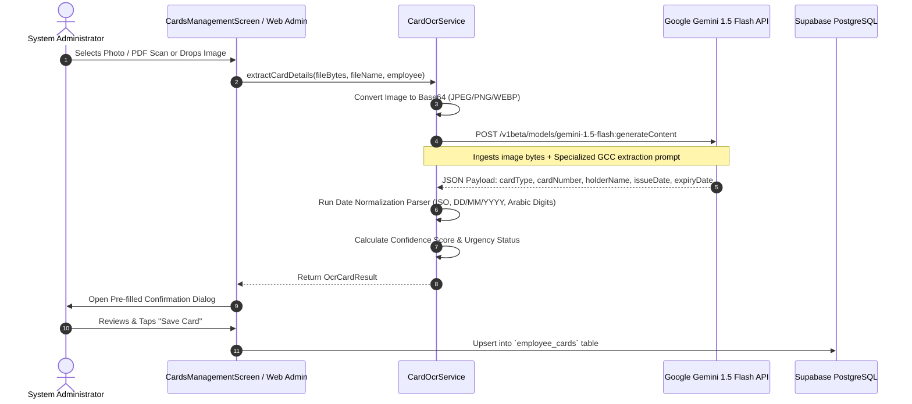
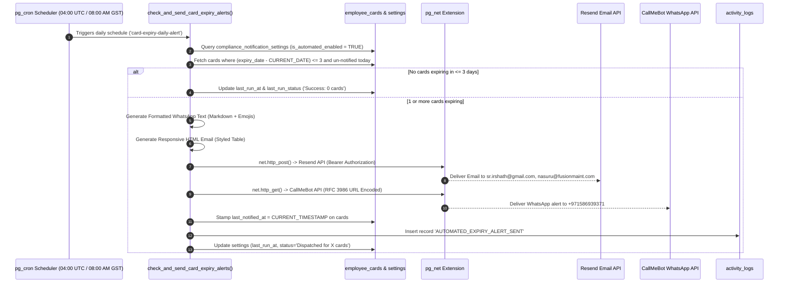

# Enterprise Cards Management & Expiry Notification Module
## Complete Technical Specification, Operational Architecture & Setup Runbook

---

## Executive Summary

In mission-critical industrial contracting, facilities management, and engineering operations across the United Arab Emirates (UAE) and Gulf Cooperation Council (GCC) region, employee credential compliance is governed by strict statutory mandates. Unexpired, government-issued identification cards, residency permits, medical insurance policies, and client-specific security passes are legally required for daily site access. 

Expired documents lead to:
1. **Immediate site gate entry denial**, halting scheduled field tasks and triggering contractual SLA penalties.
2. **Substantial municipal and labor authority fines** (such as GDRFA and ICP overstay penalties in the UAE).
3. **Severe safety and security breaches** when entering high-security energy, naval, port, or government facilities (such as MOPA and CISPA zones).

The **Enterprise Cards Management & Expiry Notification Module** provides an end-to-end, multi-tier document compliance solution built into the Fusion 360 Attendance and Workforce Suite. It eliminates manual spreadsheet tracking, prevents human data-entry errors through **Google Gemini Multimodal AI Vision OCR**, provides real-time expiry lifecycle classification, and executes an **autonomous, multi-channel notification robot** (dispatching automated daily alerts via **Resend Email API** and **CallMeBot WhatsApp API**).

---

## Table of Contents

1. [High-Level Architecture & System Workflow](#1-high-level-architecture--system-workflow)
2. [Supported Document Types & Regulatory Matrix](#2-supported-document-types--regulatory-matrix)
3. [Gemini Multimodal AI Vision OCR Engine](#3-gemini-multimodal-ai-vision-ocr-engine)
4. [Expiry Lifecycle & Classification Tiers](#4-expiry-lifecycle--classification-tiers)
5. [Autonomous Multi-Channel Notification Robot](#5-autonomous-multi-channel-notification-robot)
   - [A. Supabase Database Cron Engine (`pg_cron` & `pg_net`)](#a-supabase-database-cron-engine-pg_cron--pg_net)
   - [B. Automated Email Dispatch Engine (Resend API)](#b-automated-email-dispatch-engine-resend-api)
   - [C. Automated WhatsApp Dispatch Engine (CallMeBot API)](#c-automated-whatsapp-dispatch-engine-callmebot-api)
   - [D. Client-Side Automated Safety Dispatcher](#d-client-side-automated-safety-dispatcher)
   - [E. 1-Click Interactive Manual Dispatch Triggers](#e-1-click-interactive-manual-dispatch-triggers)
6. [Database Schema & Data Models](#6-database-schema--data-models)
7. [User Interfaces & Implementation Parity](#7-user-interfaces--implementation-parity)
   - [Flutter Mobile & Web Admin Application](#flutter-mobile--web-admin-application)
   - [Standalone Enterprise Web Admin Portal (`web_admin/`)](#standalone-enterprise-web-admin-portal-web_admin)
8. [Configuration, Onboarding & Setup Runbook](#8-configuration-onboarding--setup-runbook)
9. [Security, RLS Policies & Audit Trail](#9-security-rls-policies--audit-trail)
10. [Troubleshooting & Maintenance FAQ](#10-troubleshooting--maintenance-faq)
11. [Source Code Reference Matrix](#11-source-code-reference-matrix)

---

## 1. High-Level Architecture & System Workflow

The module operates across three distinct tiers: **Client Interfaces (Flutter & Web Admin)**, **AI Document Extraction (Gemini Multimodal Vision)**, and **Cloud Database & Serverless Cron (Supabase PostgreSQL, `pg_cron`, and `pg_net`)**.



---

## 2. Supported Document Types & Regulatory Matrix

Every tracked credential belongs to one of 7 standardized document categories, each aligned with specific GCC and UAE compliance requirements:

| Card Type Code | Human-Readable Title | Regulatory Authority & Context | Number Format & Pattern | Default Renewal Cycle |
| :--- | :--- | :--- | :--- | :--- |
| `EMIRATES_ID` | Emirates Identity Card | Federal Authority for Identity, Citizenship, Customs & Port Security (ICP). Mandatory national identity for all UAE residents. | `784-YYYY-XXXXXXX-X` (15 digits) | 2 or 3 Years (Matches Residency Visa) |
| `VISA` | UAE Residence / Work Visa | General Directorate of Residency and Foreigners Affairs (GDRFA) / ICP. Legal authorization to reside and work in the UAE. | `201/YYYY/XXXXXXX` (Unified Number or File No.) | 2 Years (Standard Private Sector) |
| `PASSPORT` | International Passport | National government of the employee's citizenship. Essential for travel, visa renewals, and legal identification. | Alphanumeric (e.g., `A12345678`, `N9876543`) | 5 to 10 Years |
| `INSURANCE` | Health & Medical Insurance | Department of Health (DOH / Thiqa / DAMAN) or Dubai Health Authority (DHA). Statutory medical coverage. | Alphanumeric Policy/Member ID (e.g., `DAMAN-GLD-998877`) | 1 Year (Annual Renewal) |
| `MOPA_PASS` | MOPA Security Pass | Ministry of Presidential Affairs. Special security clearance pass for personnel working within presidential, royal, and VIP facilities. | `MOPA-SEC-YYYY-XXXX` | 6 Months to 1 Year |
| `CISPA_PASS` | CISPA Access Pass | Critical Infrastructure and Coastal Protection Authority. Permitted access to ports, oil & gas installations, and coastal facilities. | `CISPA-PORT-XXXXX` | 6 Months to 1 Year |
| `CUSTOM_PASS` | Custom Site / Safety Permit | Client-specific contractor badge, safety induction pass, equipment operating license, or driving license. | Custom Identifier | Variable (30 Days to 1 Year) |

---

## 3. Gemini Multimodal AI Vision OCR Engine

Manual data entry of complex card numbers, Arabic-indic dates, and expiration timestamps is prone to typographical errors. The module integrates Google's **Gemini Multimodal AI Vision API** through [`lib/core/services/card_ocr_service.dart`](file:///c:/Users/srirs/.gemini/antigravity-ide/scratch/attendance_app/lib/core/services/card_ocr_service.dart) and parallel JavaScript routines in [`web_admin/app.js`](file:///c:/Users/srirs/.gemini/antigravity-ide/scratch/attendance_app/web_admin/app.js).

### Data Extraction Pipeline



### Prompt Engineering & Normalization Capabilities

1. **Document Classification**: The prompt categorizes the document strictly into one of the 7 supported `card_type` enum values.
2. **Number Cleansing**: Strips extraneous characters, recognizing hyphens in Emirates IDs (`784-1990-...`) and slashes in visa file numbers.
3. **Multi-Format Date Recognition**: Handles inconsistent GCC date formats:
   - British / International: `DD/MM/YYYY` or `DD-MM-YYYY`
   - ISO 8601: `YYYY-MM-DD`
   - Textual Months: `15 Oct 2026`, `24-DEC-2025`
   - Arabic-Indic Numerals: Translates Eastern Arabic digits (`٠١٢٣٤٥٦٧٨٩`) to standard Arabic numerals (`0-9`).
4. **Resilient Offline / Local Heuristic Parser**: If no Gemini API key is configured or the system is operating in an air-gapped environment, `CardOcrService` executes a regex-based heuristic analysis on file naming conventions and EXIF headers to populate default parameters.

---

## 4. Expiry Lifecycle & Classification Tiers

Every card in the system is evaluated dynamically against the current calendar day:

$$\Delta\text{days} = \text{expiryDate} - \text{today}$$

```
+----------------------------------------------------------------------------------------------------+
|                                    EXPIRY TIMELINE & URGENCY TIERS                                 |
+----------------------+--------------------+-----------------------------------+--------------------+
|  < 0 Days (Past)     |  0 to 3 Days       |  4 to 30 Days                     |  > 30 Days         |
|  🔴 EXPIRED          |  🚨 CRITICAL       |  🟠 EXPIRING SOON                 |  🟢 VALID          |
+----------------------+--------------------+-----------------------------------+--------------------+
|  • Immediate penalty |  • Daily automated |  • Queued in HR renewal workflow  |  • Compliant       |
|  • Site gate denied  |    email & WhatsApp|  • Included in weekly summaries   |  • Normal status   |
|  • Badges in red     |    broadcast robot |  • Warning badge in orange        |  • Green badge     |
+----------------------+--------------------+-----------------------------------+--------------------+
```

### Detailed Tier Characteristics

| Status Category | Mathematical Condition | UI Visual Indicator | Notification Trigger | Operational Action Required |
| :--- | :--- | :--- | :--- | :--- |
| **Expired** | $\Delta\text{days} < 0$ | Red Solid Badge (`EXPIRED (Xd ago)`) | Included in daily critical alert broadcast | **Immediate Escalation**: Temporary security gate passes revoked; employee cannot be dispatched to client sites. |
| **Critical Alert** | $0 \le \Delta\text{days} \le 3$ | Crimson Pulsing Badge (`Expires Today` or `Xd left`) | **Triggers Daily 08:00 AM GST Automated Notification Robot** | **High Priority**: Urgent renewal receipt or submission proof required from PRO / HR desk. |
| **Expiring Soon** | $4 \le \Delta\text{days} \le 30$ | Amber / Orange Pill (`Xd remaining`) | Visible in 30-Day compliance watchlist & Excel export | **Planned Renewal**: Medical typing, insurance quote requests, or ICP application initiated. |
| **Valid** | $\Delta\text{days} > 30$ | Emerald Green Pill (`Valid`) | Suppressed from notification alarms | **Standard Status**: Regular operational clearance. |

---

## 5. Autonomous Multi-Channel Notification Robot

The core value of the module is automated compliance guarantee: administrators and operations executives are informed proactively without needing to manually inspect reports or log into dashboards.

### Pre-Configured Operational Target Recipients
- **Primary Email Recipients**: `sr.irshath@gmail.com, nasuru@fusionmaint.com`
- **Primary WhatsApp Recipient**: `+971586939371` (Operations & Compliance Desk)
- **Verified Broadcast Email Sender**: `Fusion Compliance <compliance@fusionmaint.org>`

---

### A. Supabase Database Cron Engine (`pg_cron` & `pg_net`)

Configured in [`backend/supabase_cron_job.sql`](file:///c:/Users/srirs/.gemini/antigravity-ide/scratch/attendance_app/backend/supabase_cron_job.sql), the server-side robot executes completely headless inside Supabase PostgreSQL, independent of whether client applications or browsers are currently open.



#### Stored Procedure Highlights (`check_and_send_card_expiry_alerts`)
1. **RFC 3986 URL Encoding**: Implements an immutable PostgreSQL encoding function (`public.url_encode`) that translates line breaks, emojis, and punctuation into safe percent-encoded characters for the CallMeBot API.
2. **Notification Throttling & De-duplication**: Filters out cards where `last_notified_at::date = CURRENT_DATE`. Cards are alerted exactly once per day during the 3-day critical window, avoiding spam.
3. **Non-Blocking Asynchronous I/O**: Leverages `net.http_post` and `net.http_get` from the `pg_net` extension, ensuring PostgreSQL worker threads are never blocked by external third-party API latency.

---

### B. Automated Email Dispatch Engine (Resend API)

Emails are broadcast using the **Resend API** (Free Tier: 3,000 emails/month) via the custom verified domain `fusionmaint.org`.

- **Endpoint**: `https://api.resend.com/emails`
- **Method**: `POST`
- **Authentication**: `Bearer re_xxxxxxxxxxxxxxxxxxxxxxxxx`
- **Header Structure**:
  ```json
  {
    "from": "Fusion Compliance <compliance@fusionmaint.org>",
    "to": ["sr.irshath@gmail.com", "nasuru@fusionmaint.com"],
    "subject": "[URGENT] Compliance Alert: 2 Document(s) Expiring Within 3 Days",
    "html": "<!DOCTYPE html>..."
  }
  ```

#### Email Design & Structure
The email template incorporates an enterprise executive layout:
1. **Dark Brand Header**: Slate-900 background (`#0f172a`) with a bright cyan brand pill (`Fusion 360 • Automated Document Control`) and a 3px crimson warning border (`#ef4444`).
2. **Tabular Card Ledger**: Features Document Name, Official Number, Employee Name, Employee Code, Expiry Date, and an urgent status tag (e.g., `EXPIRES TODAY!`, `1 DAY REMAINING`, or `EXPIRED`).
3. **Action Required Callout**: Highlighted in amber warning background with explicit instructions for HR / PRO desk follow-up.
4. **Audit Metadata Footer**: Clarifies recipient destination and dispatch timestamp.

---

### C. Automated WhatsApp Dispatch Engine (CallMeBot API)

Instant messaging guarantees immediate visibility for field coordinators and site supervisors.

- **Endpoint**: `https://api.callmebot.com/whatsapp.php`
- **Method**: `GET`
- **Parameters**:
  - `phone`: `971586939371` (E.164 formatted without `+`)
  - `text`: RFC 3986 percent-encoded message
  - `apikey`: CallMeBot user API Key

#### Standardized WhatsApp Message Format

```text
🚨 *URGENT COMPLIANCE NOTICE: CARD EXPIRATION (≤ 3 DAYS)*
════════════════════════════════════════
Attention: Compliance & Operations Control
The following *2 document(s)* require immediate renewal:

*1. EMIRATES ID*
  👤 Employee: Ahmed Al Mansoori (EMP-1004)
  🏢 Dept: Operations
  🔢 Card No: 784-1988-1234567-1
  📅 Expiry: 28 Oct 2026
  ⏳ Status: EXPIRES TODAY!
────────────────────────────────────────
*2. MOPA PASS*
  👤 Employee: Rajesh Kumar (EMP-1008)
  🏢 Dept: Electrical Engineering
  🔢 Card No: MOPA-SEC-2024-88
  📅 Expiry: 30 Oct 2026
  ⏳ Status: Expires in 2 day(s)

⚠️ *Action Required:*
Please coordinate with the HR/Admin desk to submit renewals or processing receipts to prevent gate/site access deactivation.
════════════════════════════════════════
_Fusion 360 Workforce Document Control_
```

---

### D. Client-Side Automated Safety Dispatcher

In addition to the database-level cron job, the Flutter app and Web Admin feature a client-side background check service: [`CardExpiryNotificationService.runAutomatedDailyCheck()`](file:///c:/Users/srirs/.gemini/antigravity-ide/scratch/attendance_app/lib/core/services/card_expiry_notification_service.dart#L373-L429).

- **Execution Trigger**: Executes silently on admin login or whenever `CardsManagementScreen` / Web Admin is loaded.
- **Guard Condition**: Checks `localDb.getLastRobotDispatchDate() == todayStr`. If the server cron or client has already run today, execution exits immediately.
- **Purpose**: Serves as a reliable fail-safe for local development, staging environments, or scenarios where Supabase `pg_cron` is temporarily paused.

---

### E. 1-Click Interactive Manual Dispatch Triggers

Operators can manually broadcast notifications at any time directly from the user interface:

1. **Direct WhatsApp Click-to-Chat**:
   - Implemented via `launchWhatsAppClient()` using the `url_launcher` package.
   - Formats a pre-filled `https://wa.me/971586939371?text=...` deep link that launches WhatsApp Web on desktop or the native WhatsApp application on mobile devices.
2. **Direct Native Email Launcher**:
   - Implemented via `launchEmailClient()`.
   - Opens the operating system's default email client (Outlook, Apple Mail, Thunderbird, Gmail) with pre-filled subject and structured body text.
3. **Broadcast Expiry Modal**:
   - Available in both Flutter (`CardsManagementScreen`) and Standalone Web Admin (`web_admin/index.html`).
   - Allows sending immediate test broadcasts or triggering an ad-hoc check for all currently expiring credentials.

---

## 6. Database Schema & Data Models

### A. `employee_cards` Table Definition

```sql
CREATE TABLE IF NOT EXISTS public.employee_cards (
    id UUID PRIMARY KEY DEFAULT uuid_generate_v4(),
    organization_id UUID NOT NULL REFERENCES public.organizations(id) ON DELETE CASCADE,
    employee_id UUID NOT NULL REFERENCES public.employees(id) ON DELETE CASCADE,
    card_type VARCHAR(50) NOT NULL CHECK (card_type IN (
        'EMIRATES_ID', 'VISA', 'PASSPORT', 'INSURANCE', 'MOPA_PASS', 'CISPA_PASS', 'CUSTOM_PASS'
    )),
    card_name VARCHAR(100) NOT NULL,
    card_number VARCHAR(100) NOT NULL,
    issue_date DATE,
    expiry_date DATE NOT NULL,
    document_url TEXT,
    file_name VARCHAR(255),
    notes TEXT,
    last_notified_at TIMESTAMP WITH TIME ZONE,
    is_deleted BOOLEAN NOT NULL DEFAULT FALSE,
    deleted_at TIMESTAMP WITH TIME ZONE,
    created_at TIMESTAMP WITH TIME ZONE DEFAULT CURRENT_TIMESTAMP,
    updated_at TIMESTAMP WITH TIME ZONE DEFAULT CURRENT_TIMESTAMP
);

-- High-performance indexes for sub-10ms queries
CREATE INDEX IF NOT EXISTS idx_employee_cards_emp ON public.employee_cards(employee_id);
CREATE INDEX IF NOT EXISTS idx_employee_cards_org ON public.employee_cards(organization_id);
CREATE INDEX IF NOT EXISTS idx_employee_cards_expiry ON public.employee_cards(expiry_date);
CREATE INDEX IF NOT EXISTS idx_employee_cards_compliance ON public.employee_cards(is_deleted, expiry_date);
```

### B. `compliance_notification_settings` Table Definition

```sql
CREATE TABLE IF NOT EXISTS public.compliance_notification_settings (
    id UUID PRIMARY KEY DEFAULT uuid_generate_v4(),
    organization_id UUID REFERENCES public.organizations(id) ON DELETE CASCADE,
    resend_api_key TEXT,
    callmebot_api_key TEXT,
    target_email TEXT NOT NULL DEFAULT 'sr.irshath@gmail.com, nasuru@fusionmaint.com',
    target_phone TEXT NOT NULL DEFAULT '971586939371',
    is_automated_enabled BOOLEAN NOT NULL DEFAULT TRUE,
    last_run_at TIMESTAMP WITH TIME ZONE,
    last_run_status TEXT,
    created_at TIMESTAMP WITH TIME ZONE DEFAULT CURRENT_TIMESTAMP,
    updated_at TIMESTAMP WITH TIME ZONE DEFAULT CURRENT_TIMESTAMP
);
```

### C. Dart Domain Entity: `EmployeeCard`

Located at [`lib/features/admin/domain/employee_card.dart`](file:///c:/Users/srirs/.gemini/antigravity-ide/scratch/attendance_app/lib/features/admin/domain/employee_card.dart), the entity encapsulates business rules:

```dart
class EmployeeCard {
  final String id;
  final String organizationId;
  final String employeeId;
  final String cardType;
  final String cardName;
  final String cardNumber;
  final DateTime? issueDate;
  final DateTime expiryDate;
  final String? documentUrl;
  final String? fileName;
  final String? notes;
  final DateTime? lastNotifiedAt;
  final bool isDeleted;
  // ...

  /// Days remaining until expiration (calculated against midnight today)
  int get daysUntilExpiry {
    final now = DateTime.now();
    final today = DateTime(now.year, now.month, now.day);
    final exp = DateTime(expiryDate.year, expiryDate.month, expiryDate.day);
    return exp.difference(today).inDays;
  }

  bool get isExpired => daysUntilExpiry < 0;
  bool get isCritical => daysUntilExpiry >= 0 && daysUntilExpiry <= 3;
  bool get isExpiringSoon => daysUntilExpiry >= 0 && daysUntilExpiry <= 30;
  bool get isValid => daysUntilExpiry > 3;
}
```

---

## 7. User Interfaces & Implementation Parity

The module provides full feature parity across both the primary **Flutter Cross-Platform Application** and the lightweight **Standalone Web Admin Portal**.

### Flutter Mobile & Web Admin Application
- **Path**: [`lib/features/admin/presentation/cards_management_screen.dart`](file:///c:/Users/srirs/.gemini/antigravity-ide/scratch/attendance_app/lib/features/admin/presentation/cards_management_screen.dart)
- **Top Metric Cards**: Real-time KPI summaries displaying Total Inventory, Expired count, Critical (≤3d), and Active & Valid count (all unexpired cards with >3 days left).
- **Critical Expiry Banner**: Prominently displayed at the top whenever any card enters the $\le 3$ day window. Includes 1-click `WhatsApp Alert` and `Draft Email` buttons.
- **Dedicated Expiry Soon (< 30d) Tab**: Dedicated tab with count badge showing exactly which cards expire in less than 30 days (`daysUntilExpiry >= 0 && daysUntilExpiry <= 30`), allowing instant tracking and renewal pipeline planning.
- **Card Type Tabs**: Clean tab bar filtering across All, Emirates ID, Visa, Passport, Insurance, MOPA Pass, CISPA Pass, Expiring Soon (< 30d), and Custom Permits with dynamic count badges for each category.
- **Card Action Bar**:
  - `View Document`: In-app high-resolution photo and PDF document viewer.
  - `Edit Details`: Modal to revise card numbers, issue dates, or expiration dates.
  - `Delete`: Soft-deletes the card locally with cloud sync.
  - `Quick Notify`: Direct click-to-chat WhatsApp deep linking for individual employees.
- **PDF Export & Print Service**: Integrated via `printing` and `pdf` packages to generate formal card audit certificates.
- **Compliance Settings Modal**: Allows administrators to input and test Resend and CallMeBot API keys with real-time test handshake indicators.

### Standalone Enterprise Web Admin Portal (`web_admin/`)
- **Path**: [`web_admin/index.html`](file:///c:/Users/srirs/.gemini/antigravity-ide/scratch/attendance_app/web_admin/index.html), [`web_admin/app.js`](file:///c:/Users/srirs/.gemini/antigravity-ide/scratch/attendance_app/web_admin/app.js), [`web_admin/styles.css`](file:///c:/Users/srirs/.gemini/antigravity-ide/scratch/attendance_app/web_admin/styles.css)
- **Performance**: Vanilla JavaScript architecture with sub-second page loads.
- **Drag-and-Drop Dropzone**: Modern dropzone supporting drag-and-drop of card photos or PDF scans with live Gemini Vision OCR parsing.
- **Glassmorphic Card Grid**: Responsive grid displaying employee avatars, card type icons, masked numbers, formatted expiration dates, and color-coded status badges.
- **Excel Compliance Export**: Generates `Employee_Cards_Compliance_Report_YYYY-MM-DD.xlsx` containing all active cards, employee mappings, and expiration dates.

---

## 8. Configuration, Onboarding & Setup Runbook

Follow this step-by-step checklist to configure the automated notification robot in a new environment:

### Step 1: Obtain Resend API Key (Email)
1. Sign up at [Resend.com](https://resend.com) (Free Tier includes 3,000 emails/month).
2. Generate an API Key with `Sending access` (e.g., `re_abc123...`).
3. Verify your domain (e.g., `fusionmaint.org`) in Resend DNS settings. *(For testing before domain verification, Resend permits sending from `onboarding@resend.dev` to the registered account email).*

### Step 2: Obtain CallMeBot WhatsApp API Key
1. Add the CallMeBot phone number to your WhatsApp contacts: `+34 91 107 70 88` (or the latest bot number published on [CallMeBot.com](https://www.callmebot.com/blog/free-api-whatsapp-messages/)).
2. From the target phone number (`+971586939371`), send the message:
   ```text
   I allow callmebot to send me messages
   ```
3. The bot will respond with your personal API Key (e.g., `1234567`).

### Step 3: Deploy the Supabase Database Cron Job
1. Open the **Supabase Dashboard** for your project.
2. Navigate to **SQL Editor** -> **New Query**.
3. Copy the complete contents of [`backend/supabase_cron_job.sql`](file:///c:/Users/srirs/.gemini/antigravity-ide/scratch/attendance_app/backend/supabase_cron_job.sql).
4. Paste into the editor and click **Run**.
5. Verify the cron job is scheduled:
   ```sql
   SELECT jobid, jobname, schedule, active FROM cron.job;
   ```
   *Expected output: Job `card-expiry-daily-alert` scheduled at `0 4 * * *` (04:00 UTC = 08:00 AM GST).*

### Step 4: Configure API Keys in the System
1. Open the Flutter Admin App or Web Admin Portal.
2. Navigate to the **Cards & Pass Expiry** module.
3. Click the **⚙️ Robot Settings** button.
4. Enter the **Resend API Key** and **CallMeBot API Key**.
5. Confirm the target email (`sr.irshath@gmail.com, nasuru@fusionmaint.com`) and phone (`971586939371`).
6. Click **Test Resend Email** and **Test WhatsApp** to execute handshake verification.
7. Click **Save Configuration**.

### Step 5: Test Manual Execution
To manually trigger a compliance run immediately without waiting for the 08:00 AM cron:
```sql
SELECT public.check_and_send_card_expiry_alerts();
```

---

## 9. Security, RLS Policies & Audit Trail

### Row Level Security (RLS)
The `employee_cards` table enforces strict tenant isolation:
- **Administrators**: Full access to read, insert, update, and soft-delete cards for all employees within their organization.
- **Employees**: Read-only access restricted strictly to cards where `employee_id = auth.uid()`.

```sql
ALTER TABLE public.employee_cards ENABLE ROW LEVEL SECURITY;

CREATE POLICY employee_cards_admin_all ON public.employee_cards
    FOR ALL
    USING (
        EXISTS (
            SELECT 1 FROM public.users
            WHERE users.id = auth.uid()
              AND users.organization_id = employee_cards.organization_id
              AND users.role IN ('ADMIN', 'SUPER_ADMIN')
        )
    );

CREATE POLICY employee_cards_employee_read ON public.employee_cards
    FOR SELECT
    USING (
        employee_id IN (
            SELECT id FROM public.employees WHERE user_id = auth.uid()
        )
    );
```

### Audit Trail Logging
Whenever the automated compliance robot dispatches alerts, an event is logged into `public.activity_logs`:
- **Action**: `AUTOMATED_EXPIRY_ALERT_SENT`
- **Metadata**: Details containing urgent card count, target emails, target phone, and timestamp.

---

## 10. Troubleshooting & Maintenance FAQ

### Q1: Why did the automated email fail to arrive?
1. **Check Spam / Junk Folder**: Ensure messages from `compliance@fusionmaint.org` are marked as safe.
2. **Inspect Supabase Status**: Run `SELECT last_run_at, last_run_status FROM public.compliance_notification_settings;`.
3. **Verify Resend Domain**: Ensure `fusionmaint.org` has verified MX/SPF/DKIM records in Resend.
4. **Inspect `pg_net` Request Log**:
   ```sql
   SELECT id, status, response_status_code, error_message FROM net._http_response ORDER BY id DESC LIMIT 5;
   ```

### Q2: Why did CallMeBot WhatsApp return an error?
- **Handshake Verification**: CallMeBot requires the target phone number to initiate the conversation first by sending `I allow callmebot to send me messages` to the bot.
- **Phone Number Format**: The phone number must contain only numbers and country code (e.g., `971586939371`), without `+` or spaces.

### Q3: How do timezone offsets affect the 08:00 AM dispatch?
- Gulf Standard Time (GST) is **UTC+4** with no daylight saving time.
- The cron schedule `0 4 * * *` executes at **04:00 UTC**, which corresponds to **08:00 AM GST**.

### Q4: What happens if an employee has multiple expiring cards?
The notification engine groups all expiring credentials for that day into a **single consolidated email** and **single consolidated WhatsApp message**, preventing notification fatigue.

---

## 11. Source Code Reference Matrix

| Component / Layer | File Path | Primary Functionality |
| :--- | :--- | :--- |
| **Domain Model** | [`lib/features/admin/domain/employee_card.dart`](file:///c:/Users/srirs/.gemini/antigravity-ide/scratch/attendance_app/lib/features/admin/domain/employee_card.dart) | Data structure, serialization, and expiry status calculation getters. |
| **Notification Service** | [`lib/core/services/card_expiry_notification_service.dart`](file:///c:/Users/srirs/.gemini/antigravity-ide/scratch/attendance_app/lib/core/services/card_expiry_notification_service.dart) | Resend API, CallMeBot WhatsApp, mailto intent, and client-side daily check. |
| **AI Vision OCR** | [`lib/core/services/card_ocr_service.dart`](file:///c:/Users/srirs/.gemini/antigravity-ide/scratch/attendance_app/lib/core/services/card_ocr_service.dart) | Google Gemini Multimodal AI Vision extraction & GCC date normalization. |
| **Flutter UI Screen** | [`lib/features/admin/presentation/cards_management_screen.dart`](file:///c:/Users/srirs/.gemini/antigravity-ide/scratch/attendance_app/lib/features/admin/presentation/cards_management_screen.dart) | Admin UI, KPI cards, document viewer, filter tabs, and settings modal. |
| **Database Cron & SQL** | [`backend/supabase_cron_job.sql`](file:///c:/Users/srirs/.gemini/antigravity-ide/scratch/attendance_app/backend/supabase_cron_job.sql) | Automated 08:00 AM GST headless cron procedure, `pg_net` dispatch, and RLS. |
| **Web Admin App** | [`web_admin/app.js`](file:///c:/Users/srirs/.gemini/antigravity-ide/scratch/attendance_app/web_admin/app.js) | Standalone portal controller, Excel compliance export, and broadcast modal. |
| **Web Admin View** | [`web_admin/index.html`](file:///c:/Users/srirs/.gemini/antigravity-ide/scratch/attendance_app/web_admin/index.html) | HTML5 structure for cards grid, OCR dropzone, and alert banners. |
| **Web Admin Styles** | [`web_admin/styles.css`](file:///c:/Users/srirs/.gemini/antigravity-ide/scratch/attendance_app/web_admin/styles.css) | Custom styling suite, glassmorphism, and status badge pill styles. |
